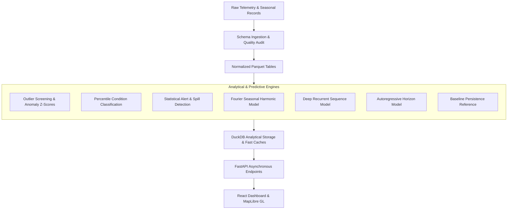

# Groundwater Intelligence & Early Warning Platform

A data-driven groundwater intelligence, monitoring, and predictive analysis platform for India and Maharashtra. The platform brings together data normalization, quality auditing, temporal and spatial analytics, deterministic condition classification, statistical anomaly alerts, multi-horizon machine learning forecasting, and an interactive geospatial dashboard.


An analytical data-access and forecasting platform providing reproducible hydrological intelligence without reliance on opaque generative shortcuts.

## Table of Contents

- [Overview](#overview)
- [Problem Statement](#problem-statement)
- [Core Objectives](#core-objectives)
- [System Architecture](#system-architecture)
- [Dataset Architecture (India vs Maharashtra)](#dataset-architecture-india-vs-maharashtra)
- [Intelligence & Modeling Engines](#intelligence--modeling-engines)
  - [1. Data Normalization & Quality Control](#1-data-normalization--quality-control)
  - [2. Deterministic Condition Classification](#2-deterministic-condition-classification)
  - [3. Statistical Anomaly & Alert Engine](#3-statistical-anomaly--alert-engine)
  - [4. Multi-Model Predictive Forecasting Suite](#4-multi-model-predictive-forecasting-suite)
  - [5. Hydrogeological Diagnostics & Sparse-Data Calibrated Fallback](#5-hydrogeological-diagnostics--sparse-data-calibrated-fallback)
  - [6. Drought, Flood, and Stress Intelligence](#6-drought-flood-and-stress-intelligence)
- [Technology Stack](#technology-stack)
- [Repository Structure](#repository-structure)
- [Step-by-Step Setup Guide (For Cloners)](#step-by-step-setup-guide-for-cloners)
  - [1. System Prerequisites](#1-system-prerequisites)
  - [2. Clone the Repository](#2-clone-the-repository)
  - [3. Backend Setup (Python & FastAPI)](#3-backend-setup-python--fastapi)
  - [4. Data Initialization (Rebuilding Normalized Parquet)](#4-data-initialization-rebuilding-normalized-parquet)
  - [5. Frontend Setup (React & Vite)](#5-frontend-setup-react--vite)
  - [6. Verifying the Full Stack](#6-verifying-the-full-stack)
- [API Reference](#api-reference)
- [Scientific Limitations](#scientific-limitations)
- [Authors & License](#authors--license)

## Overview

The Groundwater Intelligence & Early Warning Platform is an analytical platform designed to monitor, evaluate, and forecast groundwater table dynamics across Indian monitoring wells. The platform ingests heterogeneous observations, standardizes schemas, handles outliers, builds historical seasonal baselines, and runs parallel statistical and machine learning models to forecast future water level trajectories under varying monsoon recharge scenarios.

## Problem Statement

Groundwater modeling faces several practical challenges:
- **Heterogeneous Observations**: Data collection frequencies differ widely between historical manual records and modern telemetry sensors.
- **Diverging Semantic Contexts**: Long-term national records are periodic and sparse, whereas Maharashtra Digital Water Level Recorder (DWLR) stations provide high-frequency continuous telemetry.
- **Sensor Spikes and Missing Datums**: Sensor malfunctions, irregular battery drops, and unknown surface datums complicate standard time-series routines.
- **Deceptive Metrics in Hydrology**: Naive global accuracy or R² often rewards flat persistence predictions because water levels move slowly week-to-week, failing to provide meaningful drought or flood advance warnings.
- **Fragmented Workflows**: Decision makers frequently lack a single platform that ties together temporal trends, spatial maps, multi-model forward horizons, and explicit data diagnostics.

Note: This system provides academic and engineering decision-support intelligence. It does not replace official statutory publications issued by the Central Ground Water Board (CGWB) or State Ground Water Surveys and Development Agencies (GSDA).

## Core Objectives

1. Maintain an immutable raw data pipeline that preserves source records.
2. Standardize heterogeneous telemetry and periodic well data into normalized Parquet files.
3. Compute seasonal percentiles and multi-year empirical baselines.
4. Detect statistical deviations and generate automated monitoring alerts.
5. Provide continuous forward trajectories using Fourier seasonal harmonics, deep recurrent sequences, and autoregressive models.
6. Provide interactive climate scenario toggles (Normal, Deficit, and Excess Monsoon recharge).
7. Transparently diagnose sparse observations and compute calibrated harmonic fallbacks.
8. Expose all analytical models through a high-performance, asynchronous FastAPI backend backed by in-memory DuckDB queries.
9. Deliver an interactive dashboard with MapLibre GL geospatial clustering, ECharts continuous trajectory visualizations, and drawer inspection workflows.

## System Architecture



## Dataset Architecture (India vs Maharashtra)

The platform isolates national periodic observations from state telemetry to maintain semantic accuracy:

| Dimension | India Dataset | Maharashtra Dataset |
|---|---|---|
| **Observation Cadence** | Historical, periodic (seasonal / annual) | High-frequency telemetry (DWLR) |
| **Primary Metric** | Relative depth / head to local datum | Depth to water table in meters below ground level (m bgl) |
| **Observation Count** | Multi-decade historical samples | 1,000+ telemetry stations with daily/weekly records |
| **Forecasting Scope** | Historical condition & long-term trend | Multi-model continuous forward trajectories (up to 2 years) |
| **Primary Analytical Role** | Regional baselines & historical stress | Real-time alerts, seasonal turnaround, and predictive modeling |

## Intelligence & Modeling Engines

### 1. Data Normalization & Quality Control
- Raw readings are validated against physical plausibility filters (extreme sensor spikes where delta exceeds 25 meters are isolated).
- Observation timestamps are parsed to Indian Standard Time (IST) ISO-8601 strings.
- Non-destructive processing ensures source records remain untouched.

### 2. Deterministic Condition Classification
- Water levels are ranked against site-specific historical seasonal percentiles:
  - `EXTREMELY_LOW` (P < 10th percentile)
  - `LOW` (10th <= P < 25th percentile)
  - `NORMAL_RANGE` (25th <= P <= 75th percentile)
  - `HIGH` (75th < P <= 90th percentile)
  - `EXTREMELY_HIGH` (P > 90th percentile)
  - `INSUFFICIENT_HISTORY` (fewer than 15 baseline samples)

### 3. Statistical Anomaly & Alert Engine
- Evaluates recent observation residual movements against rolling historical variance:
  - `NORMAL`: Within expected seasonal variance envelope.
  - `WATCH`: 1 to 2 standard deviations from baseline.
  - `WARNING`: Exceeding 2 standard deviations.
  - `CRITICAL_STATISTICAL_DEVIATION`: Severe statistical outlier requiring immediate field inspection.

### 4. Multi-Model Predictive Forecasting Suite
The platform implements parallel forecasting engines running on verified telemetry:
- **Seasonal Harmonic Model**: Uses annual, semi-annual, and quarterly Fourier decomposition ($\sin/\cos$ terms) with Huber loss regression ($\delta=1.35$) to project seasonal drawdown and monsoon turnaround trajectories.
- **Deep Recurrent Sequence Model**: A 2-layer LSTM network with LayerNorm and spatial conditioning, trained on 30-day sliding observation windows.
- **Autoregressive Horizon Model**: A multi-step chained recursive model rolled forward across user-selected horizons.
- **Baseline Persistence Reference**: The non-parametric benchmark assuming future levels equal the latest validated measurement.
- **Monsoon Climate Scenarios**: Simulates impacts of Normal ($1.0\times$ baseline recharge), Deficit ($-20\%$ drought stress), and Excess ($+20\%$ surplus infiltration).
- **Evaluation Standards**: Evaluated on Directional Trend Precision, Physical Mean Absolute Error (MAE in meters), and 80% Confidence Interval empirical coverage.

### 5. Hydrogeological Diagnostics & Sparse-Data Calibrated Fallback
- Replaces generic missing data errors with a detailed diagnostic audit covering sample count, observation span, and threshold criteria.
- Stations with sparse records automatically engage regional seasonal Fourier harmonics with widened empirical uncertainty bounds ($\pm 1.8\text{ m}$) instead of throwing errors.

### 6. Drought, Flood, and Stress Intelligence
- **Drought Intelligence**: Evaluates consecutive deficit quarters and spatial coverage.
- **Flood Potential**: Retrospective multi-signal classification combining sharp hydraulic head rises with localized rainfall indicators.
- **Aquifer Stress**: Identifies multi-year chronic depletion trends independent of single-season monsoon fluctuations.

## Technology Stack

- **Backend Language**: Python 3.10+
- **API Framework**: FastAPI 0.115 with Uvicorn
- **Analytical Storage**: DuckDB, PyArrow, Apache Parquet
- **Machine Learning**: LightGBM, PyTorch, Scikit-learn, NumPy, Pandas
- **Frontend Framework**: React 19, TypeScript 5.x, Vite
- **Mapping & Geospatial**: MapLibre GL JS, React-Map-GL
- **Data Visualization**: Apache ECharts (`echarts-for-react`)
- **Icons & Styling**: Tailwind CSS, Lucide React

## Repository Structure

```text
groundwater/
├── data/                       # Local datasets (Parquet binaries excluded from git)
│   ├── alerts/                 # Causal alert artifacts
│   ├── conditions/             # Baseline condition Parquet files
│   ├── processed/              # Normalized observation records
│   └── raw/                    # Raw source telemetry and survey files
├── docs/                       # Technical methodologies and documentation
├── frontend/                   # React + TypeScript single-page application
│   ├── src/
│   │   ├── components/         # Dashboard tabs, map views, charts, and drawer panels
│   │   ├── services/           # Typed API client functions
│   │   ├── utils/              # Color schemes, formatters, and alert configurations
│   │   ├── App.tsx             # Root dashboard controller and routing
│   │   └── index.css           # Design tokens, variables, and typography
│   ├── package.json
│   └── vite.config.ts
├── models/                     # Trained forecasting weights and metadata JSONs
│   └── advanced_forecast/
├── scripts/                    # Training and data processing utilities
│   ├── rebuild_processed_from_alerts.py
│   ├── train_seasonal_harmonic.py
│   └── train_lstm_forecast.py
├── src/                        # Core Python backend package
│   ├── alerting/               # Statistical anomaly detection
│   ├── api/                    # FastAPI routes and DuckDB Data Access Layer
│   │   ├── routes/             # Candidate sites, forecasts, analytics
│   │   ├── dal.py              # In-memory DuckDB query layer
│   │   └── main.py             # FastAPI entry point
│   ├── data/                   # Data loaders and schema normalizers
│   ├── features/               # Spatial DBSCAN and temporal engineering
│   └── forecasting/            # Chained step forecaster
├── tests/                      # Pytest suite
├── requirements.txt            # Python dependencies
└── README.md
```

## Step-by-Step Setup Guide (For Cloners)

Follow these exact steps to clone, configure, and launch the platform locally.

### 1. System Prerequisites
Ensure your machine has the following tools installed:
- **Git**: `git --version`
- **Python**: Version 3.10 or higher (`python3 --version` or `python --version`)
- **Node.js**: Version 18 or higher (`node --version`) and npm (`npm --version`)

If working on Windows, Windows Subsystem for Linux (WSL) or Git Bash is recommended.

### 2. Clone the Repository
```bash
git clone https://github.com/SSujal-Pawarr/groundwater.git
cd groundwater
```

### 3. Backend Setup (Python & FastAPI)

Create and activate a clean Python virtual environment:

On Linux / macOS / WSL:
```bash
python3 -m venv .venv
source .venv/bin/activate
```

On Windows (PowerShell):
```powershell
python -m venv .venv
.\.venv\Scripts\Activate.ps1
```

Install the required Python libraries:
```bash
pip install --upgrade pip
pip install -r requirements.txt
```

### 4. Data Initialization (Rebuilding Normalized Parquet)
Because large raw datasets and normalized Parquet files are excluded from Git to prevent repository bloat, rebuild the normalized analytical tables from the included alert artifacts:

```bash
python scripts/rebuild_processed_from_alerts.py
```

This script will verify your directories and populate `data/processed/maharashtra/maharashtra_normalized.parquet` and related reference tables without modifying any existing files.

### 5. Frontend Setup (React & Vite)

Open a new terminal window or tab, navigate to the `frontend` folder, and install dependencies:

```bash
cd frontend
npm install
```

### 6. Running the Platform

#### Terminal 1: Launch Backend API
In the project root with your virtual environment active:
```bash
python -m uvicorn src.api.main:app --host 0.0.0.0 --port 8000 --reload
```
The API server will start on `http://127.0.0.1:8000`. You can inspect the interactive OpenAPI documentation by opening `http://127.0.0.1:8000/docs` in your browser.

#### Terminal 2: Launch Frontend Development Server
In the `frontend` directory:
```bash
npm run dev
```
The Vite development server will start on `http://localhost:5173`.

Open your browser to **`http://localhost:5173`** to access the dashboard.

## API Reference

The backend exposes read-only analytical endpoints over HTTP:

| Endpoint | Method | Description |
|---|---|---|
| `/health` | GET | Health check confirming database connectivity and memory caches. |
| `/api/v1/{region}/candidate-sites` | GET | List candidate monitoring stations with coordinates and current intelligence states. |
| `/api/v1/{region}/candidate-sites/{id}/telemetry` | GET | Chronological historical telemetry readings for a specific station. |
| `/api/v1/{region}/candidate-sites/{id}/alerts` | GET | Historical anomaly alert records and standardized scores. |
| `/api/v1/{region}/candidate-sites/{id}/condition` | GET | Latest percentile condition classification and sample counts. |
| `/api/v1/maharashtra/advanced-forecast` | GET | Parallel multi-model forward predictions with continuous trajectories and confidence intervals. |
| `/api/v1/maharashtra/advanced-forecast/map` | GET | Statewide predicted water level conditions for all monitoring stations. |
| `/api/v1/maharashtra/advanced-forecast/models` | GET | Formal benchmark precision metrics (Directional Precision, Physical MAE, 80% CI). |

Supported `{region}` path parameters are `india` and `maharashtra`.

## Scientific Limitations

To ensure transparency and academic integrity, this system maintains the following boundaries:
1. **Not a Statutory Authority**: The platform does not issue official CGWB groundwater categorizations (Safe, Semi-Critical, Critical, Over-Exploited).
2. **Proxy Flood Potential**: Flood potential assessments are derived from groundwater level rates of rise combined with weather proxies; they do not replace surface hydraulic flood models or local civil protection warnings.
3. **No Demand-Side Extrapolation**: Groundwater stress metrics reflect observed physical drawdown and deficit persistence; they do not measure volumetric domestic or industrial water consumption.
4. **Analytical Groupings for India**: National candidate sites represent spatial-analytical coordinate clusters, as verified physical well metadata is not standardized across all historical records.
5. **Deterministic Auditability**: Forecasts provide bounded projections based on verified trends; they should be interpreted as scientific estimates subject to ongoing telemetry updates.

## Authors & License

This project was developed as an engineering initiative focused on groundwater monitoring, predictive modeling, and hydrogeological analytics.

Repository: [https://github.com/SSujal-Pawarr/groundwater](https://github.com/SSujal-Pawarr/groundwater)
