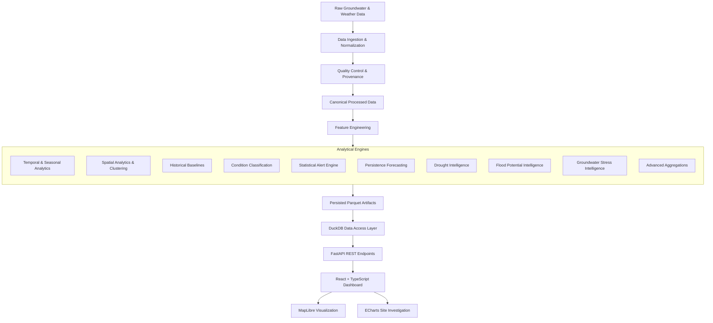
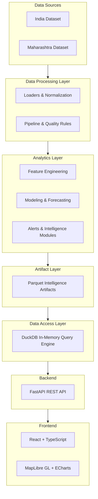

# Groundwater Intelligence & Early Warning Platform

A deterministic, data-driven groundwater intelligence and early warning platform for India and Maharashtra. This system combines data quality control, temporal and spatial analytics, deterministic groundwater condition classification, statistical alerting, persistence forecasting, drought intelligence, groundwater flood potential assessment, groundwater stress intelligence, and an interactive geospatial dashboard.


*A robust data-access and analytics layer serving deterministic hydrological insights without reliance on non-deterministic generative models.*

---

## Table of Contents

- [Overview](#overview)
- [Problem Statement](#problem-statement)
- [Objectives](#objectives)
- [Key Capabilities](#key-capabilities)
- [System Architecture](#system-architecture)
- [End-to-End Data Flow](#end-to-end-data-flow)
- [Dataset Architecture (India vs Maharashtra)](#dataset-architecture-india-vs-maharashtra)
- [Scientific Intelligence Modules](#scientific-intelligence-modules)
  - [1. Data Quality](#1-data-quality)
  - [2. Feature Engineering](#2-feature-engineering)
  - [3. Baseline Analytics](#3-baseline-analytics)
  - [4. Condition Intelligence](#4-condition-intelligence)
  - [5. Statistical Alert Engine](#5-statistical-alert-engine)
  - [6. Forecasting](#6-forecasting)
  - [7. Drought Intelligence](#7-drought-intelligence)
  - [8. Groundwater Flood Potential](#8-groundwater-flood-potential)
  - [9. Groundwater Stress](#9-groundwater-stress)
  - [10. Advanced Analytics](#10-advanced-analytics)
- [Software Architecture](#software-architecture)
- [Technology Stack](#technology-stack)
- [Repository Structure](#repository-structure)
- [API Reference](#api-reference)
- [Frontend Architecture](#frontend-architecture)
- [Installation & Running](#installation--running)
- [Validation and Performance](#validation-and-performance)
- [Experimental Models](#experimental-models)
- [Design Principles](#design-principles)
- [Scientific Limitations (What we do NOT claim)](#scientific-limitations-what-we-do-not-claim)
- [Data Provenance](#data-provenance)
- [Development Milestones](#development-milestones)
- [Roadmap](#roadmap)
- [License & Author](#license--author)

---

## Overview

The Groundwater Intelligence & Early Warning Platform is an analytical backend and geospatial frontend designed to monitor, classify, and predict groundwater conditions across Indian candidate monitoring sites. The platform aggregates heterogeneous observational data, applies rigorous normalization and quality control, and computes historical baselines to derive actionable scientific intelligence.

---

## Problem Statement

Groundwater analytics is notoriously difficult due to:
- **Heterogeneous Observations**: Data is collected across varying intervals, formats, and physical standards.
- **Varying Semantic Contexts**: The historical India dataset is periodic and long-term, whereas the Maharashtra DWLR dataset is telemetry-oriented and higher frequency.
- **Data Quality Issues**: Missing provenance, unknown reference datums, measurement gaps, and irregular sampling intervals complicate time-series analysis.
- **Need for Transparent Interpretation**: Raw depth-to-water numbers lack context without historical baselines.
- **Lack of Unified Assessment**: There is a critical need for an early-warning signal system that unifies temporal analytics, spatial clustering, and condition classification in one transparent API layer.

**Note**: This platform provides project-level intelligence and decision support. It **does not** replace official Central Ground Water Board (CGWB) assessments or state-level regulatory metrics.

---

## Objectives

1. Establish a non-destructive groundwater data pipeline.
2. Normalize heterogeneous observations and preserve data-quality provenance.
3. Generate temporal, spatial, and seasonal features.
4. Establish persistence and historical baselines.
5. Detect statistical groundwater deviations and trigger alerts.
6. Classify historical groundwater conditions contextually.
7. Provide Maharashtra next-observation persistence forecasting.
8. Provide long-term groundwater drought intelligence for regions with sufficient historical data.
9. Provide evidence-based retrospective groundwater flood potential assessments where supported by meteorological alignment.
10. Provide structural groundwater stress intelligence without falsely claiming overall water scarcity.
11. Expose all deterministic intelligence through a read-only FastAPI service layer.
12. Provide an interactive MapLibre GL JS React dashboard for visualization.

---

## Key Capabilities

| Capability | Description | Coverage |
|------------|-------------|----------|
| **Data Ingestion & Normalization** | Schema validation, coordinate correction, candidate-site resolution. | Both |
| **Data Quality** | Anomaly screening, duplicate handling, quality flags preservation. | Both |
| **Feature Engineering** | Temporal mapping, seasonal grouping, spatial clustering (DBSCAN). | Both |
| **Baseline Analytics** | Historical percentiles and median observation comparisons. | Both |
| **Condition Engine** | Deterministic classification into `NORMAL_RANGE`, `LOW`, `EXTREMELY_HIGH`, etc. | Both |
| **Statistical Alerts** | Standard deviation threshold alerts (`WATCH`, `WARNING`, `CRITICAL`). | Both |
| **Persistence Forecasting** | Next-valid-observation prediction using baseline persistence. | Maharashtra |
| **Drought Intelligence** | Assessment based on consecutive deficit seasons and spatial coverage. | India |
| **Flood Potential** | Evidence-based multi-signal classification combining levels and weather. | Maharashtra |
| **Groundwater Stress** | Structural trend and percentile decline analysis (not scarcity measurement). | India |
| **Advanced Analytics** | District-level aggregations and cross-intelligence metric fusion. | Both |
| **REST API** | DuckDB-powered fast data access layer returning canonical JSON payloads. | Both |
| **Interactive Dashboard** | React + MapLibre visualization with dynamic charting (ECharts). | Both |

---

## System Architecture



## End-to-End Data Flow

```mermaid
flowchart LR
    Obs[Raw Observations] --> Norm[Schema Normalization]
    Norm --> Sites[Candidate-Site ID]
    Sites --> QA[Quality Filtering]
    QA --> Eng[Feature Generation]
    Eng --> Intel[Intelligence Engines]
    Intel --> Parquet[Parquet Artifacts]
    Parquet --> DuckDB[DuckDB Read Layer]
    DuckDB --> API[FastAPI]
    API --> UI[React Dashboard]
```



---

## Dataset Architecture (India vs Maharashtra)

The platform explicitly separates data semantics to prevent misinterpreting long-term history vs short-term telemetry. **These datasets MUST NOT be interpreted as equivalent.**

| Property | India Dataset | Maharashtra Dataset |
|----------|---------------|---------------------|
| **Observation type** | Historical / Periodic | Telemetry-oriented |
| **Temporal resolution** | Sparse, seasonal, decadal history | Higher-frequency (often monthly) |
| **Unit** | Relative depth/levels (often unverified datum) | Depth to water level (meters) |
| **Reference datum** | Unknown / Implied Ground Level | Generally Ground Level |
| **Forecast semantics** | Not supported (gaps too wide) | Next-valid-observation persistence |
| **Weather integration** | Not applicable | Retrospective evidence mapping |
| **Alert semantics** | Long-term deviations | Short-term rolling threshold breaks |
| **Main analytical role** | Drought & Stress Intelligence | Flood Potential & Telemetry Alerts |

---

## Scientific Intelligence Modules

### 1. Data Quality
The [Cleaning Methodology](docs/cleaning_methodology.md) explicitly protects raw data immutability. It includes:
- Quality flagging for outliers (values `≤ 0` or `≥ 150` are flagged, not physically impossible but suspect).
- Duplicate observation conflict resolution (preferring maximum severity or median values).
- Coordinate corrections for malformed lat/lons.
*Note: Screening thresholds are QA rules, not strict physical groundwater laws.*

### 2. Feature Engineering
The [Feature Engineering Methodology](docs/feature_engineering_methodology.md) extracts:
- Temporal features (Year, Month, gap duration).
- Seasonal features (Pre-Monsoon, Monsoon, Post-Monsoon).
- Spatial features (DBSCAN clustered candidate sites).
- Anomaly baselines.
Leakage is strictly prevented by only utilizing chronologically prior data for reference baselines.

### 3. Baseline Analytics
Calculates the historical median and interquartile range for each candidate site within matching seasonal windows. Machine learning experiments were strictly isolated from production baselines.

### 4. Condition Intelligence
Contextually classifies observations using site-specific historical percentiles. 
States include: `EXTREMELY_LOW`, `LOW`, `NORMAL_RANGE`, `HIGH`, `EXTREMELY_HIGH`, and `INSUFFICIENT_HISTORY`.
*Note: `EXTREMELY_LOW` is a percentile state and does not automatically equate to a declared hydrological drought.*

### 5. Statistical Alert Engine
Evaluates persistence residual deviations against a rolling historical reference (z-score style analysis).
Alert thresholds yield: `WATCH`, `WARNING`, `CRITICAL_STATISTICAL_DEVIATION`, or `NORMAL`. The engine accounts for sequence gaps and applies recovery cooldowns. These are project-defined statistical alerts, not regulatory classifications. See [Alert Methodology](docs/alert_engine_methodology.md).

### 6. Forecasting
The production model utilizes a **Persistence Forecast** for Maharashtra data.
It relies on the latest valid observation and baseline season averages to predict the *next valid observation*. It does not project into an arbitrary future horizon to avoid fabricated timelines. Experimental weather/XGBoost models are documented but not used as the primary production engine. See [Forecasting Assessment](docs/m8_3_forecasting_assessment.md).

### 7. Drought Intelligence (M10)
Analyzes long-term seasonal history. Utilizes the historical percentile approach, measuring consecutive deficit seasons and spatial regional coverage to determine states (e.g., `STATE_WATCH`, `STATE_MODERATE`, `STATE_SEVERE`). It explicitly refuses to claim equivalence to the official CGWB GWDI. See [M10 Drought Methodology](docs/m10_drought_methodology.md).

### 8. Groundwater Flood Potential (M11)
An evidence-based multi-signal classification (groundwater rise rate + extreme percentile + weather proxy) resulting in states like `ELEVATED_POTENTIAL` or `HIGH_POTENTIAL`. **This is not a physical flood prediction model nor an official flood warning.** See [M11 Flood Intelligence](docs/m11_flood_intelligence_methodology.md).

### 9. Groundwater Stress (M12)
Focuses on long-term structural decline (persistent negative trends, consecutive deficits) rather than absolute scarcity. It explicitly acknowledges the absence of demand-side data, extraction rates, and reservoir levels. States include `PERSISTENCE_MIN_SEASONS_STRESS` and `REGIONAL_COVERAGE_STRESS`. See [M12 Stress Intelligence](docs/m12_stress_intelligence_methodology.md).

### 10. Advanced Analytics (M16)
Provides district-level aggregation, percentile trajectories, cross-intelligence metric fusion, and site-level statistics. It operates exclusively on deterministic signals. See [M16 Methodology](docs/m16_advanced_analytics_methodology.md).

---

## Future Forecast (M17): multi-horizon XGBoost

Predicts the groundwater level **h months ahead** and classifies the **future condition state**, then keeps the horizon with the best held-out accuracy.

1. **Stage 1: `XGBRegressor`** predicts the future water level (as a change from the current level) for each feasible horizon (1, 6, 12 months).
2. **Horizon selection:** feasible horizons are compared on held-out R² (also reports MAE/RMSE and skill vs a persistence baseline); the most accurate wins, ties go to the shorter horizon.
3. **Stage 2: `XGBClassifier`** takes the regressor output (out-of-fold, so no in-sample leakage) and predicts the future state (`EXTREMELY_LOW … EXTREMELY_HIGH`, same P10/P25/P75/P90 thresholds as M8.2-D).

```bash
python -m src.forecasting.pipeline --region maharashtra      # 1-month (only horizon the data supports)
python -m src.forecasting.pipeline --region india            # compares 6 vs 12 months (1 month is not observable)
```

Outputs: `data/future_forecast/*.parquet|json`, `models/future_forecast/*.json`, `docs/future_forecast_results_<region>.json`.
API: `GET /api/v1/{region}/candidate-sites/{id}/future-forecast`, `/api/v1/{region}/future-forecast`, `/api/v1/{region}/future-forecast/summary`.
Details, results and limitations: [`docs/future_forecast_methodology.md`](docs/future_forecast_methodology.md).

### Rough estimate beyond the end of the data (chained forecast)
When the data ends before today, `python -m src.forecasting.chain --region maharashtra|india [--target-date YYYY-MM-DD]` rolls a step model forward to the target date.
Every output is labelled `ESTIMATED_WITHOUT_RECENT_DATA`, uses the last known level when a backtest shows the model is no better than "unchanged",
and carries backtest-based (or flagged, extrapolated) uncertainty plus warnings (e.g. no monsoon in Maharashtra's training data). See the addendum in
[`docs/future_forecast_methodology.md`](docs/future_forecast_methodology.md).

## Software Architecture



---

## Technology Stack

| Layer | Technology | Purpose |
|-------|------------|---------|
| **Backend API** | Python, FastAPI | Serves deterministic endpoints; processes requests and queries data. |
| **Data Engine** | DuckDB, Pandas, PyArrow | Fast, in-memory SQL execution directly over local Parquet artifacts. |
| **Scientific Logic**| NumPy, scikit-learn | Spatial clustering (DBSCAN), standard scaler, mathematical baselines. |
| **Frontend Core** | React 19, TypeScript, Vite | Fast, typed, modern component architecture for the dashboard UI. |
| **Geospatial UI** | MapLibre GL JS, react-map-gl | Renders high-performance interactive geospatial data maps and clusters. |
| **Charting UI** | ECharts, react-markdown | Dynamic visual trajectories, condition graphs, timeline analytics. |
| **Styling** | Tailwind CSS 4 | Utility-first responsive component styling. |
| **Testing** | pytest, Vitest | Backend and frontend unit/regression validation. |

*(Note: The platform is fully deterministic. All previously experimental LLM/RAG/AI integrations have been intentionally excluded from the production system.)*

---

## Repository Structure

```text
Ground_Water_Intelligence/
├── data/                       # Raw inputs and generated Parquet intelligence artifacts
├── docs/                       # Comprehensive methodological and architectural documentation
├── frontend/                   # React + TypeScript Vite application
│   ├── src/
│   │   ├── components/         # Map, charts, layout components
│   │   ├── services/           # API fetch wrappers
│   │   ├── types/              # TypeScript interface definitions
│   │   └── App.tsx             # Main dashboard assembly
│   └── package.json            # Frontend dependency manifest
├── notebooks/                  # Experimental Jupyter notebooks (EDA, ML experiments)
├── src/                        # Core Python backend
│   ├── alerting/               # Engine for calculating statistical deviations
│   ├── api/                    # FastAPI endpoints and DuckDB Data Access Layer
│   │   ├── dal.py
│   │   ├── main.py
│   │   └── routes/             # Candidate sites, analytics, health routes
│   ├── data/                   # Loaders, normalization, quality control, pipeline runners
│   ├── features/               # Temporal, spatial, conditions, M10, M11, M12 engines
│   └── models/                 # Persistence forecasting and evaluation modules
├── tests/                      # Extensive pytest regression suite
├── requirements.txt            # Python dependencies
└── README.md                   # This file
```

---

## API Reference

The backend operates on `http://127.0.0.1:8000` locally. All endpoints are read-only (`GET`).

| Endpoint | Purpose | Region Support |
|----------|---------|----------------|
| `/health` | System status and DAL verification. | Core |
| `/{region}/candidate-sites` | Retrieves all valid geographic sites with current intelligence states. | India, Maharashtra |
| `/{region}/candidate-sites/{id}/telemetry` | Retrieves normalized historical timeline observations. | India, Maharashtra |
| `/{region}/candidate-sites/{id}/alerts` | Retrieves statistical alert timeline for a site. | India, Maharashtra |
| `/{region}/candidate-sites/{id}/condition` | Retrieves site-specific baseline condition distribution. | India, Maharashtra |
| `/maharashtra/candidate-sites/{id}/forecast` | Retrieves persistence baseline next-observation forecast. | Maharashtra |
| `/{region}/candidate-sites/{id}/analytics` | Retrieves cross-intelligence summary (Stress, Drought, Flood). | India, Maharashtra |
| `/{region}/candidate-sites/{id}/percentile-trajectory` | Retrieves percentile trajectory trend data. | India, Maharashtra |
| `/{region}/candidate-sites/{id}/timeline` | Retrieves structured timeline fusing observations, alerts, conditions. | India, Maharashtra |
| `/{region}/districts/{district}/analytics` | Retrieves district-level coverage and intelligence aggregation. | India, Maharashtra |

*Path Parameters: `{region}` must be `india` or `maharashtra`.*

---

## Frontend Architecture

The frontend is a `React` + `TypeScript` single-page application built with `Vite`. It utilizes `Tailwind CSS` for layout. 

**Dashboard Highlights:**
- **Map View:** Powered by `MapLibre GL`, dynamically coloring clusters and candidate sites based on their latest scientific condition or alert state.
- **Context Selector:** Global toggle to switch analytics context between the historical "India" dataset and the telemetry "Maharashtra" dataset.
- **Site Investigation Panel:** Displays deep-dive ECharts representing timeline data, percentile trajectories, statistical alerts, and derived intelligence (Stress, Flood, Drought).

---

## Installation & Running

### Prerequisites
- Python 3.10+
- Node.js 18+ and npm
- Git

### 1. Clone the repository
```powershell
git clone https://github.com/vedsongire/Ground_Water_Intelligence.git
cd Ground_Water_Intelligence
```

### 2. Backend Setup
```powershell
# Create and activate a virtual environment
python -m venv .venv
.\.venv\Scripts\Activate.ps1   # On Windows
# source .venv/bin/activate    # On macOS/Linux

# Install requirements
pip install -r requirements.txt

# Run the FastAPI server
python -m uvicorn src.api.main:app --reload
```
The API will be available at `http://127.0.0.1:8000`. (View Swagger UI at `/docs`).

> **Empty map / "0 sites in view"?** `data/processed/` is git-ignored, so a fresh clone has no normalized files.
> Rebuild them from the alert artifacts (never overwrites existing files):
> `python scripts/rebuild_processed_from_alerts.py`

### 3. Frontend Setup
Open a new terminal window:
```powershell
cd frontend
npm install
npm run dev
```
The Dashboard will be available at `http://localhost:5173`.

---

## Validation and Performance

The system enforces strict deterministic validation to ensure intelligence rules operate exactly as intended.

**Current Validation Snapshot:**
- **Backend (pytest):** `154 passed` (100% coverage of core logic pathways)
- **Frontend (Vitest):** `31 passed` (Component and API service testing)
- **Production Build:** Successfully builds without TypeScript or CSS errors.

---

## Experimental Models

While the production platform utilizes highly transparent, explainable **Persistence Forecasting**, earlier project phases experimented with meteorological integration and Machine Learning models (XGBoost, HistGradientBoosting).

**Scientific Conclusion:**
Experimental tracking demonstrated that complex non-linear ML models (like XGBoost) did not uniformly outperform simple persistence baselines given the sparse temporal frequency of historical groundwater data. To maintain strict scientific transparency, the platform relies on the reproducible persistence baseline for production APIs. *See [M9 Model Comparison Results](docs/m9_model_comparison_results.md).*

---

## Design Principles

- **Correctness over Sophistication:** Mathematical transparency is prioritized over "black-box" predictions.
- **Raw Data Immutability:** Source data is never destructively altered.
- **No Fabricated Data:** Missing timestamps are preserved as gaps, not interpolated blindly.
- **Chronological Validation:** Leakage is prevented; baselines only look into the past.
- **Deterministic Intelligence:** All alerts, conditions, and assessments are derived from strict, traceable rules.
- **Semantic Separation:** India and Maharashtra datasets undergo fundamentally separated analytical workflows respecting their physical differences.

---

## Scientific Limitations (What we do NOT claim)

To maintain scientific credibility, this project explicitly outlines its limitations:
1. **Not a Regulatory Standard:** This system does not issue official CGWB groundwater classifications or regulatory mandates.
2. **Not a Physical Flood Predictor:** The Flood Potential intelligence is an evidence-based retrospective proxy; it does not constitute an official flood warning and lacks absolute topographic/surface-water context.
3. **Not an Absolute Scarcity Measure:** Groundwater Stress intelligence measures structural groundwater decline. It does not measure absolute water scarcity, as demand-side data, extraction data, and reservoir capacities are absent.
4. **No Verified Physical Identities for India:** Candidate-site identifiers in the India dataset are analytical groupings, as verified physical station IDs were unavailable in the raw source.
5. **No Causal Attribution:** Trends and deviations are identified statistically; hydrological causal attribution is not claimed.
6. **No Universal Hydrological Modeling:** We do not simulate sub-surface aquifer mechanics (Modflow, etc.).

---

## Data Provenance

- **India Groundwater Dataset:** Historical, periodic spatial observations. Reference datums and exact extraction semantics are assumed standardized relative to historical baselines.
- **Maharashtra DWLR Dataset:** Digital Water Level Recorder telemetry network.
- **Methodology Documentation:** All logic is documented in the `/docs` directory. 
  - [Cleaning Methodology](docs/cleaning_methodology.md)
  - [Alert Engine Methodology](docs/alert_engine_methodology.md)
  - [M10 Drought Intelligence](docs/m10_drought_methodology.md)
  - [M11 Flood Intelligence](docs/m11_flood_intelligence_methodology.md)
  - [M12 Stress Intelligence](docs/m12_stress_intelligence_methodology.md)

---

## Development Milestones

| Milestone | Area | Status |
|-----------|------|--------|
| M3 | Data ingestion & quality | Complete |
| M4 | Feature engineering | Complete |
| M5 | Baselines & forecasting experiments | Complete |
| M6 | Alert engine | Complete |
| M7 | API / DuckDB data access | Complete |
| M8 | Dashboard / weather intelligence experiments | Complete |
| M9 | XGBoost model evaluations | Complete |
| M10 | Drought intelligence | Complete |
| M11 | Flood potential intelligence | Complete |
| M12 | Groundwater stress intelligence | Complete |
| M16 | Advanced analytics & cross-intelligence | Complete |
| M17 | Final Dashboard integration | Complete |

*(Note: M13-M15 involved conversational AI experiments which were intentionally removed from the final architecture to keep the submitted system deterministic and scientifically rigorous.)*

---

## Roadmap

Reasonable future extensions could include:
- Incorporation of verified physical station identities and aquifer geometries.
- Ingestion of localized demand/extraction datasets.
- Extension of the Maharashtra historical record as more telemetry is collected.
- Integration of higher-resolution Digital Elevation Models (DEM) for flood mapping context.

---

## License & Author

**License:** Not yet specified.

**Author:** 
Ved Songire 
Electronics and Computer Science 
Vidyalankar Institute of Technology, Mumbai 
GitHub: [https://github.com/vedsongire](https://github.com/vedsongire)
